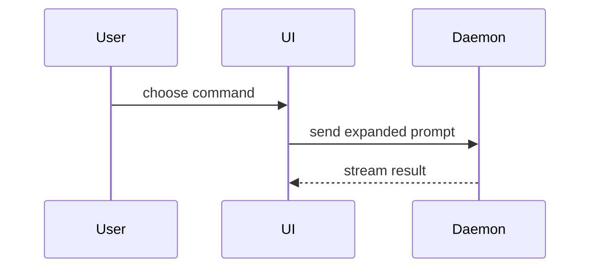

Use the following template to write the PR body. The PR body must include both Chinese and English versions, organized as follows:

1. **Chinese Version**: Write the entire PR body in Chinese, following the template.
2. **English Version**: After completing the Chinese version, write the entire PR body in English, following the same template.

**Do not alternate between Chinese and English within sections.** Complete the full Chinese version first, followed by the full English version.

Note that only the English version of the template is provided below.

```markdown
## Summary

<diagram, diff-sketch, or tree>

## Task List

- [x] <completed change or verified behavior> — <concrete result, scope, or command>
- [ ] <known follow-up or unverified check, if any> — <what remains and why>

## Evidence

- **Before:** <screenshot/output/failing test run>
  **After:** <screenshot/output/passing test run>

## Merge Danger

**Door:** <one-way or two-way>

<optional: description>

**Blast Radius:** <one-word description>

<optional: potential ramifications of merge>
```

## Sections

Skip all preambles and keep prose brief. Use the user's domain language from `GLOSSARY.md`.

### Summary

Pick the smallest view that makes the key point clear.

- Show logic or an algorithm as pseudocode:

```text
on(save)
  if content is unchanged
    return cached result
  write new content
  return fresh result
```

- Show runtime control flow as a call tree:

```text
submitForm
  createSession
    persistPrompt
    launchAgent
  navigateToSession
```

- Show UI structure as a component tree, including state and module boundaries that matter:

```text
<SessionPage> (apps/example/src/routes/session.tsx)
  useSessionEvents()
  <SessionToolbar>
    <RunSkillButton> (packages/ui)
```

- Show file responsibility or a broad refactor as a shallow file tree:

```text
src/
├── commands/       # parses user actions
├── sessions/       # owns session state
└── transport/      # sends API requests
```

- Show component interaction, control flow, or data flow with Mermaid:



- Use `diff` when the point is what changes and the surrounding shape already exists. Match the diff shape to the topic.

For a component change:

```diff
 <SessionPage>
   useSessionEvents()
   <SessionToolbar>
+    <RunSkillButton />
   <SessionTimeline>
+    <SkillResultCard />
```

For a file-layout change:

```diff
 src/
 ├── commands/
+│   └── show-me.ts       # expands the slash command
 ├── sessions/
-└── transport.ts
+└── transport/
+    ├── client.ts
+    └── stream.ts
```

For a call-tree or call-stack change:

```diff
 submitForm
   createSession
     persistPrompt
+    expandSkillMention
     launchAgent
-  navigateToSession
+  navigateToSession
+    subscribeToEvents
```

For a state or control-flow change:

```diff
 on(save)
-  write content
+  if content is unchanged
+    return cached result
+  write new content
+  invalidate cache
```

- Show the whole block when most of it is new, when omitted context would hide ownership or order, or when the user needs a copyable target shape:

```ts
function expandSkill(command: string): string {
  const skillName = command.slice(1);
  return `use the ${skillName} skill`;
}
```

#### Guidance

Place each visual next to the short text it supports. Keep only the calls, files, props, states, and boundaries needed to answer the user's current question or the options to resolve the current discussion point.

You may use one of these, you may use several, it is unlikely you will use all of them. Use your judgement and don't overwhelm the user.

### Task List

Include a Markdown task list in **both** the Chinese and English versions of every PR body. Use `- [x]` and `- [ ]` checkboxes to make progress and remaining work scannable.

This is a **general-purpose task list, not necessarily a test plan**. Choose the most useful items for this PR: implemented changes, behavior or integration checks, automated tests, manual validation, release/preparation steps, and known follow-ups. Prefer concrete, meaningful tasks over generic claims such as "done" or "tested". Use inline commands, results, affected areas, or short context when they add clarity.

- Mark `[x]` **only for work actually completed or checks actually performed**, supported by the available changes, logs, or user-provided evidence. Never imply that a test ran just because a script exists.
- Mark `[ ]` for real outstanding work, skipped verification, or known limitations. Briefly explain why when useful. Do not invent unfinished tasks merely to fill the list.
- Keep items concise and specific, generally one line each. Group related tasks or use a more descriptive heading only when it improves readability; do not force the heading `Test Plan`.
- Capture the most important details, not an exhaustive history. Avoid repeating long explanations from Summary or Evidence.
- The Chinese version should contain the **entire checklist in Chinese**, followed later by the **entire equivalent checklist in English**. Keep the items, ordering, and checked/unchecked states consistent across the two versions.

Example task-list shape (illustrative only; do not claim these actions occurred unless confirmed):

```markdown
## Task List

- [x] Update the request-handling flow — preserve streaming responses
- [x] Verify the package build — `npm run build` passed
- [ ] Manually check the Windows desktop flow — not run yet
```

### Evidence

Concrete evidence that the change works. Show a before and after.

Screenshots are S-tier - when the environment is set up for it and the change is visual.

Execution-based evidence is A-tier. Test results, console output. Show the exact test that now fails and passes, using pseudocode.

### Merge Danger

Describe whether it's a one-way or two-way door. You can walk back through two-way doors, but not one-way doors. A PR that is cheap to roll back is lower risk. Changes that involve destructive actions or hard-to-reverse decisions are one-way doors.

The blast radius is the potential impact or scope of the changes introduced by this PR. Consider all possibilities. Examples are layout shift, breakages for consumers, mobile responsiveness, etc.
