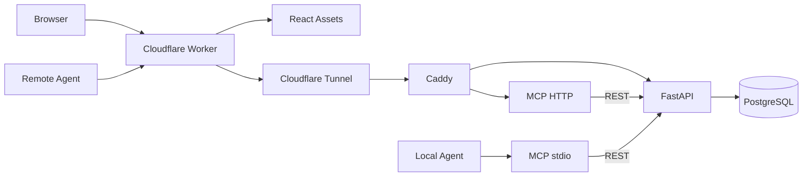

# Architecture

English · [简体中文](ARCHITECTURE.zh-CN.md)

## Components and Ownership

Cloudflare **only serves the web frontend and public ingress**. The Worker serves built React files with Assets and proxies `/api/*` and `/mcp` to a fixed HTTPS Tencent origin. It never connects to PostgreSQL, runs task business rules, or hosts the MCP server.

The Tencent Cloud environment runs Docker Compose services: `api` (FastAPI/SQLAlchemy), `db` (PostgreSQL), `mcp` (Node.js/MCP SDK Streamable HTTP), `router` (Caddy), and optionally `tunnel` (cloudflared).

## Network and Authentication Boundaries

Web, REST, and remote MCP share one public Worker hostname. The Worker proxies only allowed paths and serves everything else through Assets. `ORIGIN_URL` comes from the trusted Worker runtime, not client input. The gateway overwrites forged `X-Tasklutein-Gateway` headers with its `ORIGIN_GATEWAY_TOKEN` secret. Browser cookies and non-allowlisted headers are dropped. Origin 3xx redirects are rejected to avoid forwarding credentials elsewhere.

On Tencent, FastAPI and HTTP MCP first verify `EDGE_GATEWAY_TOKEN` (matching the Worker secret), then separately enforce browser/agent Bearer Tokens. FastAPI derives report authorship from authentication rather than trusting client JSON. Both browser and agent credentials currently allow full read/write access to one shared workspace, without user isolation or OAuth.

A Cloudflare Tunnel origin hostname may be reachable directly, but without the gateway secret, FastAPI/MCP refuse access. PostgreSQL, FastAPI, and Caddy host ports bind to `127.0.0.1` only; MCP HTTP publishes no host port. Production needs independent strong random secrets, Cloudflare rate limiting, and security monitoring.

## Database and API as Source of Truth

PostgreSQL is the production source of truth. `apps/api/migrations/0001_init.sql` initializes the existing Compose volume setup; `apps/api/alembic/` contains the versioned migration baseline. Existing databases must be inspected before an operator stamps that baseline. Tasks store title, description, status, and timestamps; reports reference tasks through a cascading foreign key. FastAPI owns validation, pagination, full-workspace summaries, and all writes. MCP calls REST, preserving one business-rule boundary for browsers and agents.

## MCP Transports and Limits

`apps/mcp/src/server.ts` registers six tools, including paginated task/report readers. `index.ts` uses stdio. `http.ts` implements the Streamable HTTP server on Tencent. The HTTP transport is stateless, with an independent transport per request: suitable for scaling but no cross-request session state, server-initiated notifications, or event replay. It uses a static Bearer Token; OAuth, dynamic client registration, and public MCP Registry publication are not implemented.

The Worker forwards requests and streaming responses. MCP GET/SSE features depend on server transport support. The current stateless server primarily uses POST/JSON, and must not be advertised as a durable resumable SSE session server. Remote MCP clients must support custom Authorization headers.

## Code Boundaries and Extensibility

- `apps/web/`: React interface and Vite/Tailwind build.
- `apps/edge/`: Cloudflare Worker, HTTP gateway, and static Assets binding.
- `apps/api/`: FastAPI application, PostgreSQL models, Alembic migrations, and API tests.
- `apps/mcp/`: Node MCP stdio/HTTP adapters using the FastAPI REST contract.
- `apps/api/migrations/0001_init.sql`: SQL bootstrap for a new PostgreSQL volume.
- `deploy/`: Docker Compose, Caddy, and Tunnel configuration.
- `scripts/` and `test/`: repository operations and cross-service integration tests.

Business rules and database access remain in FastAPI as the API and MCP services run independently behind the gateway.
