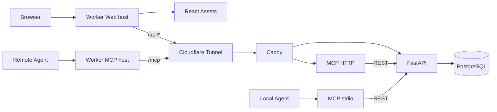

# Architecture

English · [简体中文](ARCHITECTURE.zh-CN.md)

## Components and Ownership

The Cloudflare Worker serves the React assets and public ingress. The deployment configures separate Web and MCP hostnames: the Web host serves static pages and proxies `/api/*`; the MCP host proxies only `/mcp`. The Worker does not connect to PostgreSQL, run business rules, or host the MCP server.

The Tencent Cloud environment runs Docker Compose services: `api` (FastAPI/SQLAlchemy), `db` (PostgreSQL), `mcp` (Node.js/MCP SDK Streamable HTTP), `router` (Caddy), and optionally `tunnel` (cloudflared). Both browsers and agents reach the origin through the Worker. The MCP server calls FastAPI through REST.

## Network and Identity Boundaries

The Web and MCP services use separate Worker hostnames. The Web hostname proxies `/api` and `/api/*` to the API, serves other paths from static Assets, and rejects `/mcp`. The MCP hostname accepts only the exact `/mcp` path and returns `404` for other paths. The Worker reads the origin URL and gateway secret from its trusted runtime, replaces client-supplied `X-Tasklutein-Gateway`, removes forged internal identity headers, and rejects origin 3xx redirects.

The static Web frontend is public; guests see a non-interactive interface preview and do not request workspace data. Cloudflare Access protects `/api/*`, and Web users authenticate with One-time PIN. The Worker uses the configured Access issuer, audience, and public JWKS to verify the RS256 signature and the `iss`, `aud`, `exp`, and `sub` claims in `Cf-Access-Jwt-Assertion`; it also requires a valid `email`. The Worker sends the verified issuer, subject, and email to FastAPI in internal headers. FastAPI accepts those headers only after the origin gateway secret is verified; the Worker removes and replaces client-supplied headers with those names. The browser does not use a business Bearer token. `POST /api/session/bootstrap` provisions or reads the personal workspace after sign-in. `GET /api/session/login` is an Access-protected login entry that returns the browser to the home page after authentication. A more-specific Access application allows the `/api/health` check without user identity.

The Web Access applications use a 30-day application session, and their Allow Policies inherit that duration. This does not change the global Cloudflare Access session duration. A valid retained cookie can be reused when reopening the site; after expiry, explicit sign-out, or cookie removal, the user must authenticate again.

FastAPI identifies users by Access issuer and subject and creates one personal workspace for a first-time user. Users can also create team workspaces and invite registered accounts; invitees join as members after accepting. Workspace lists and each resource request are authorized against `workspace_members`. The browser selects a workspace with `X-Tasklutein-Workspace-ID`; omitting it selects the personal workspace. The Worker forwards this selection header and strips forged internal identity headers. Tasks, reports, Overview data, activity, history, comments, reviews, and Agent keys are scoped to the selected workspace; a resource outside it is treated as missing. Report source, user attribution, and Agent-key attribution come from the verified identity, not client-supplied ownership fields. If the email for an existing Access identity changes, it is synchronized to the user record.

Users can create multiple Agent keys in the selected workspace, edit their names and expiries, or permanently delete them in Settings. Each key is bound to exactly one workspace, and every authentication checks that its creator remains a member there. Plaintext is returned only once in the create response; the database stores a SHA-256 digest and short display prefix. Key lists expose only `tlu_` plus the next three characters. Deletion physically removes the key row and digest; reports, comments, and activities remain with their `agent_token_id` cleared. The remote MCP host requires `Authorization: Bearer <Agent key>` and validates the key through `/api/agent/whoami`. Removing a member invalidates their team key without affecting their personal keys. MCP does not use the browser's Cloudflare Access session.

The Worker and origin separately verify `ORIGIN_GATEWAY_TOKEN` and `EDGE_GATEWAY_TOKEN` (the same value). FastAPI and HTTP MCP verify the gateway secret before business requests. PostgreSQL, FastAPI, and Caddy host ports bind to `127.0.0.1` only; the MCP HTTP port is not published on the host. A Cloudflare Tunnel hostname may be directly reachable, but API and MCP business endpoints still require the gateway secret.

## Database, Isolation, and Legacy Data Migration

PostgreSQL is the production source of truth. `apps/api/migrations/0001_init.sql` initializes the legacy base tables for a new volume; `apps/api/alembic/` holds versioned migrations. `0002_identity_workspace` creates user, personal-workspace, and Agent-key tables, adds a nullable workspace link to existing tasks, and adds nullable identity attribution to reports. `0003_task_workspace_required` makes the task workspace link mandatory. `0004_task_history` adds the nullable UTC `archived_at` task field and creates a workspace-scoped activity table. `0005_report_comments` adds report comments with cascading deletion through the report foreign key. `0006_agent_token_hard_delete` permits physical Agent-key deletion and clears references in reports and comments. `0007_team_review_concurrency` adds team membership and invitations, task assignees and versions, and report reviews.

Migrations do not run automatically when the API starts. When upgrading an existing database, first migrate it to `0002_identity_workspace`, then have the intended owner sign in through Cloudflare Access to create that user's record and personal workspace. If unassigned tasks remain, the maintainer then explicitly sets `TASKLUTEIN_LEGACY_OWNER_ISSUER`, `TASKLUTEIN_LEGACY_OWNER_SUBJECT`, and `TASKLUTEIN_LEGACY_OWNER_EMAIL` while running `0003_task_workspace_required`, and sets `TASKLUTEIN_LEGACY_TASKS_CONFIRM` to `assign-existing-tasks`. The owner must match all three identity values, be enabled, and already have a workspace, or the migration fails. It assigns all unowned tasks to that one workspace and then makes the task workspace field non-null; it does not guess or split the old shared data. Existing task and report content and report source are preserved. Legacy reports have no recoverable user or key attribution, so `actor_user_id` and `agent_token_id` remain null. Then apply `0004_task_history`, `0005_report_comments`, `0006_agent_token_hard_delete`, and `0007_team_review_concurrency`. Revision `0007` marks all existing workspaces as personal and backfills their owner memberships without moving task, report, comment, activity, or key rows or changing their IDs; existing task versions start at `1`. If no unassigned tasks exist, the legacy-owner settings are not required.

Tasks store title, description, status, assignee, workspace ID, monotonically increasing version, and timestamps; assignees must be members of the same workspace. Reports reference tasks through a cascading foreign key, and reviews are unique per report and reviewer. Tasks with a null `archived_at` appear in current lists, search, Overview, and MCP task tools; all of those queries exclude archived tasks. Archiving freezes the original task row, retaining its ID and all fields, along with every associated report, comment, and review. Archived tasks, reports, comments, and reviews remain readable; comments and reviews cannot be written after archive. Clearing history for an archived task physically deletes the task, reports, comments, reviews, and activity; clearing history for a task that remains current deletes its reports, comments, reviews, and activity while retaining its fields and state.

FastAPI writes activity in the same database transaction as each real task or report change. Event types are `task.created`, `task.updated`, `task.status_changed`, `task.deleted`, and `report.created`. A no-op task PATCH neither changes `updated_at` nor creates an event. A PATCH that changes status and other fields creates one `task.status_changed` event. Activity summaries contain only controlled changed-field and before/after status values; they do not copy task descriptions, report bodies, or secrets. Users can delete activity records, so this is business history and does not provide a tamper-proof security audit guarantee.

Task PATCH requests must include the `expected_version` read by the caller. FastAPI locks the task and compares versions; a missing version returns `428`, and a stale version returns `409 task_version_conflict` with the latest task. For a real edit, field changes, version increment, and activity write commit in one PostgreSQL transaction. No-op requests change neither the version nor `updated_at`. MCP `update_task` requires the same version and tells Agents to reread and compare after a conflict; the API does not retry automatically. Removing a member clears their task assignments and increments affected versions in the same transaction.

Task updates, report creation, archiving, and whole-history cleanup lock the target task and check its archive state, preventing report writes after archive. Task data and activity share a transaction; an activity write failure rolls back the corresponding business change. FastAPI scopes history and activity queries by the current `workspace_id` and verified Principal. Reports, comments, reviews, and activities retain the verified user ID; they retain an Agent-key ID while the key exists, and clear `agent_token_id` when the key is permanently deleted. History source and user attribution remain, while the deleted key's name is no longer shown. On reads, `actor_name` is resolved from the associated record's current email or name, so email synchronization or key renaming changes the displayed name on older records. The system does not store a name snapshot for the time of the operation; legacy reports with unrecoverable attribution retain only their source. MCP calls REST so the browser and Agents share the same business rules.

Comments are flat records attached to individual reports, without reply threads. Web users and Agent keys can read and add comments within their workspace; only Web users can physically delete them. Comment creation and deletion write no activity and do not update task `updated_at`. MCP exposes `list_report_comments` and `add_report_comment` through FastAPI REST.

Reviews are separate records, not comments. Human members can submit a 1–5 score, an `approved` or `needs_work` verdict, and an optional note. A repeat submission updates that reviewer's existing record. Agents can read reviews but cannot submit them. `/api/inbox` returns the current user's unarchived assigned tasks and the latest unreviewed report from another actor for each task; it does not send notifications or push updates.

After a task has been archived, an older backend that ignores `archived_at` could show it in the current list again. A rollback version must retain archive filtering and workspace isolation; removing the history schema requires separate review and cannot be done by deleting history records.

## MCP Transports and Limits

`apps/mcp/src/server.ts` provides eight tools, including paginated task, report, and report-comment readers; `index.ts` provides the local stdio adapter; `http.ts` implements the remote Streamable HTTP server. Remote MCP uses stateless HTTP: each POST uses an independent transport and returns JSON. It has no cross-request session state, server-initiated notifications, or event replay. The HTTP server accepts POST only, with a 1 MiB request-body limit. OAuth, dynamic client registration, and public MCP Registry publication are not implemented. Clients need support for a custom Authorization header.

The Worker forwards HTTP requests and response streams to the origin. The remote MCP host is separate from the Web host; `/mcp` on the Web host is not forwarded to the MCP server. MCP GET/SSE capabilities depend on the server transport implementation; the current stateless service does not provide a durable resumable SSE session.

## Code Boundaries

- `apps/web/`: React interface and Vite/Tailwind build.
- `apps/edge/`: Cloudflare Worker, Access JWT verification, host/path routing, HTTP gateway, and static Assets binding.
- `apps/api/`: FastAPI application, PostgreSQL models, Alembic migrations, and API tests.
- `apps/mcp/`: Node MCP stdio/HTTP adapters using the FastAPI REST API.
- `apps/api/migrations/0001_init.sql`: base SQL bootstrap for a new PostgreSQL volume.
- `deploy/`: Docker Compose, Caddy, and Tunnel configuration.
- `scripts/` and `test/`: repository maintenance tools and cross-service integration tests.

The API and MCP are separate services reached through the Worker; task business rules and database access remain in FastAPI.
