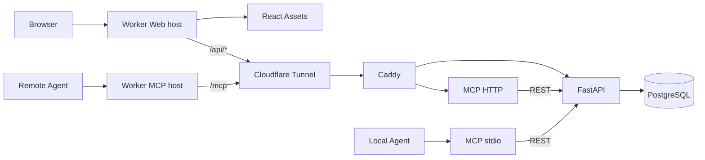

# Architecture

English · [简体中文](ARCHITECTURE.zh-CN.md)

## Components and Ownership

The Cloudflare Worker serves the React assets and public ingress. The deployment configures separate Web and MCP hostnames: the Web host serves static pages and proxies `/api/*`; the MCP host proxies only `/mcp`. The Worker does not connect to PostgreSQL, run business rules, or host the MCP server.

The Tencent Cloud environment runs Docker Compose services: `api` (FastAPI/SQLAlchemy), `db` (PostgreSQL), `mcp` (Node.js/MCP SDK Streamable HTTP), `router` (Caddy), and optionally `tunnel` (cloudflared). Both browsers and agents reach the origin through the Worker. The MCP server calls FastAPI through REST.

## Network and Identity Boundaries

The Web and MCP services use separate Worker hostnames. The Web hostname proxies `/api` and `/api/*` to the API, serves other paths from static Assets, and rejects `/mcp`. The MCP hostname accepts only the exact `/mcp` path and returns `404` for other paths. The Worker reads the origin URL and gateway secret from its trusted runtime, replaces client-supplied `X-Tasklutein-Gateway`, removes forged internal identity headers, and rejects origin 3xx redirects.

Web users authenticate through Cloudflare Access. The Worker uses the configured Access issuer, audience, and public JWKS to verify the RS256 signature and the `iss`, `aud`, `exp`, and `sub` claims in `Cf-Access-Jwt-Assertion`; it also requires a valid `email`. The Worker sends the verified issuer, subject, and email to FastAPI in internal headers. FastAPI accepts those headers only after the origin gateway secret is verified; the Worker removes and replaces client-supplied headers with those names. The browser does not use a business Bearer token. `GET /api/health` is a health check that does not require user identity.

FastAPI identifies users by Access issuer and subject and creates one personal workspace for a first-time user. Tasks, reports, Overview counts, and Agent keys are scoped to that workspace; a task outside the caller's workspace is treated as missing. Report source, user attribution, and Agent-key attribution come from the verified identity, not client-supplied ownership fields. If the email for an existing Access identity changes, it is synchronized to the user record.

Each user can create multiple personal Agent keys in Settings, with an optional expiry, and revoke each key separately. Plaintext is returned only in the creation response; the database stores its SHA-256 digest and a display prefix. The remote MCP host requires `Authorization: Bearer <Agent key>` and validates the key through `/api/agent/whoami`. A key can access only its owner's personal workspace. MCP does not use the browser's Cloudflare Access session.

The Worker and origin separately verify `ORIGIN_GATEWAY_TOKEN` and `EDGE_GATEWAY_TOKEN` (the same value). FastAPI and HTTP MCP verify the gateway secret before business requests. PostgreSQL, FastAPI, and Caddy host ports bind to `127.0.0.1` only; the MCP HTTP port is not published on the host. A Cloudflare Tunnel hostname may be directly reachable, but API and MCP business endpoints still require the gateway secret.

## Database, Isolation, and Legacy Data Migration

PostgreSQL is the production source of truth. `apps/api/migrations/0001_init.sql` initializes the legacy base tables for a new volume; `apps/api/alembic/` holds versioned migrations. `0002_identity_workspace` creates user, personal-workspace, and Agent-key tables, adds a nullable workspace link to existing tasks, and adds nullable identity attribution to reports. `0003_task_workspace_required` makes the task workspace link mandatory.

Migrations do not run automatically when the API starts. When upgrading an existing database, first migrate it to `0002_identity_workspace`, then have the intended owner sign in through Cloudflare Access to create that user's record and personal workspace. If unassigned tasks remain, the maintainer then explicitly sets `TASKLUTEIN_LEGACY_OWNER_ISSUER`, `TASKLUTEIN_LEGACY_OWNER_SUBJECT`, and `TASKLUTEIN_LEGACY_OWNER_EMAIL` while running `0003_task_workspace_required`, and sets `TASKLUTEIN_LEGACY_TASKS_CONFIRM` to `assign-existing-tasks`. The owner must match all three identity values, be enabled, and already have a workspace, or the migration fails. It assigns all unowned tasks to that one workspace and then makes the task workspace field non-null; it does not guess or split the old shared data. Existing task and report content and report source are preserved. Legacy reports have no recoverable user or key attribution, so `actor_user_id` and `agent_token_id` remain null. If no unassigned tasks exist, the legacy-owner settings are not required.

Tasks store title, description, status, timestamps, and workspace ID; reports reference tasks through a cascading foreign key. FastAPI owns validation, pagination, workspace summaries, and database writes. MCP calls REST so the browser and agents share the same business rules.

## MCP Transports and Limits

`apps/mcp/src/server.ts` provides six tools, including paginated task and report readers; `index.ts` provides the local stdio adapter; `http.ts` implements the remote Streamable HTTP server. Remote MCP uses stateless HTTP: each POST uses an independent transport and returns JSON. It has no cross-request session state, server-initiated notifications, or event replay. The HTTP server accepts POST only, with a 1 MiB request-body limit. OAuth, dynamic client registration, and public MCP Registry publication are not implemented. Clients need support for a custom Authorization header.

The Worker forwards HTTP requests and response streams to the origin. The remote MCP host is separate from the Web host; `/mcp` on the Web host is not forwarded to the MCP server. MCP GET/SSE capabilities depend on the server transport implementation; the current stateless service does not provide a durable resumable SSE session.

## Code Boundaries

- `apps/web/`: React interface and Vite/Tailwind build.
- `apps/edge/`: Cloudflare Worker, Access JWT verification, host/path routing, HTTP gateway, and static Assets binding.
- `apps/api/`: FastAPI application, PostgreSQL models, Alembic migrations, and API tests.
- `apps/mcp/`: Node MCP stdio/HTTP adapters using the FastAPI REST API.
- `apps/api/migrations/0001_init.sql`: base SQL bootstrap for a new PostgreSQL volume.
- `deploy/`: Docker Compose, Caddy, and Tunnel configuration.
- `scripts/` and `test/`: repository maintenance tools and cross-service integration tests.

The API and MCP are separate services reached through the Worker; task business rules and database access remain in FastAPI.
