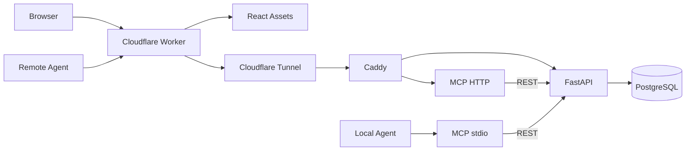

# 架构

[English](ARCHITECTURE.en.md) · 简体中文

## 组件与归属

Cloudflare **只负责静态前端与公网网关**。Worker 通过 Assets binding 提供 React 构建后的文件，将 `/api/*` 和 `/mcp` 代理到固定的腾讯云 HTTPS 源站；它不连接 PostgreSQL、不执行任务逻辑、不托管 MCP Server。

腾讯云环境通过 Docker Compose 运行 `api` (FastAPI/SQLAlchemy)、`db` (PostgreSQL)、`mcp` (Node.js/MCP SDK Streamable HTTP)、`router` (Caddy) 和可选的 `tunnel` (cloudflared)。

## 网络与认证边界

公网 Web、REST 和远程 MCP 共用一个 Worker 主机名。Worker 只代理指定路径，静态路由交给 Assets；`ORIGIN_URL` 来自可信 Worker 运行环境而不是用户请求。网关覆盖客户端伪造的 `X-Tasklutein-Gateway` Header，注入 Worker Secret `ORIGIN_GATEWAY_TOKEN`；客户端 Cookie、非白名单 Header 不会被传给源站。Worker 拒绝源站 3xx 重定向，避免凭据转发到其他目标。

腾讯云环境中的 FastAPI 和 MCP HTTP 先验证 `EDGE_GATEWAY_TOKEN`（与 Worker Secret 值相同），之后仍需验证独立的浏览器/Agent Bearer Token。FastAPI 从认证结果而不是客户端 JSON 设置报告来源。当前 Web Token 和 Agent Token 都拥有整个工作空间的读写权限，不提供用户级别隔离或 OAuth。

Cloudflare Tunnel 的公开 hostname 可被直接访问，但没有网关密钥会被 FastAPI/MCP 拒绝；它不是无需认证的业务后门。PostgreSQL、FastAPI、Caddy 的宿主机端口仅绑定 `127.0.0.1`；MCP HTTP 端口不发布到宿主机。生产环境使用固定、强随机且彼此独立的密钥，并在 Cloudflare 添加速率限制和审计监控。

## 数据与 API 的唯一事实源

生产数据库采用 PostgreSQL。`apps/api/migrations/0001_init.sql` 保留现有 Compose 卷初始化路径；`apps/api/alembic/` 保存版本化迁移基线。已有数据库先核对 Schema，再由维护者 stamp 到基线。Task 保存标题、说明、状态和时间戳；Report 通过级联外键关联任务。FastAPI 负责输入校验、分页、全工作区统计和全部写入；MCP 只调用 REST，让浏览器与 Agent 共用业务规则。

## MCP 传输与限制

`apps/mcp/src/server.ts` 声明六个工具，包含分页读取任务和汇报的能力；`index.ts` 使用 stdio；`http.ts` 提供腾讯云 Streamable HTTP Server。HTTP MCP 为无状态、每请求独立传输模式，适合横向扩展，但不支持跨请求会话状态、服务端主动通知或事件恢复。当前使用固定 Bearer Token，不实现 OAuth、自动客户端注册或公共 MCP Registry 发布。

Worker 转发 HTTP 请求体和响应流；MCP 的 GET SSE 能力是否可用取决于实际 Server 传输支持。当前无状态 HTTP Server 主要使用 POST/JSON 响应；不应声称支持可恢复的长期 SSE 会话。MCP 客户端必须能够设置自定义 Authorization Header，否则不能直接使用该远程接口。

## 代码边界与扩展

- `apps/web/`：React 界面和 Vite/Tailwind 构建。
- `apps/edge/`：Cloudflare Worker、HTTP 网关与静态 Assets 绑定。
- `apps/api/`：FastAPI 应用、PostgreSQL 模型、Alembic 迁移及 API 测试。
- `apps/mcp/`：使用 FastAPI REST 接口的 Node MCP stdio/HTTP 适配器。
- `apps/api/migrations/0001_init.sql`：新建 PostgreSQL 数据卷的 SQL 初始化脚本。
- `deploy/`：Docker Compose、Caddy 和 Tunnel 配置。
- `scripts/` 与 `test/`：仓库级维护工具与跨服务集成测试。

API 与 MCP 作为独立服务通过网关访问，业务规则和数据库写入仍集中在 FastAPI。
