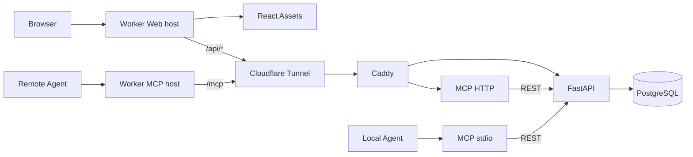

# 架构

[English](ARCHITECTURE.en.md) · 简体中文

## 组件与归属

Cloudflare Worker 提供 React 静态资源和公网入口。部署为 Web 主机和 MCP 主机配置两个 hostname：Web 主机提供静态页面并代理 `/api/*`；MCP 主机只代理 `/mcp`。Worker 不连接 PostgreSQL、不执行业务规则，也不托管 MCP Server。

腾讯云环境通过 Docker Compose 运行 `api`（FastAPI/SQLAlchemy）、`db`（PostgreSQL）、`mcp`（Node.js/MCP SDK Streamable HTTP）、`router`（Caddy）和可选的 `tunnel`（cloudflared）。浏览器和 Agent 都经 Worker 到达源站，MCP Server 再通过 REST 调用 FastAPI。

## 网络与身份边界

Web 与 MCP 使用不同的 Worker hostname。Web hostname 将 `/api` 和 `/api/*` 转发到 API，其他路径交给静态 Assets，并拒绝 `/mcp` 路径。MCP hostname 只接受精确的 `/mcp`，其他路径返回 `404`。Worker 从可信运行环境读取源站 URL 和网关密钥；它覆盖客户端提供的 `X-Tasklutein-Gateway`，剥除客户端伪造的内部身份 Header，并拒绝源站 3xx 重定向。

Web 静态前端可公开访问；游客只看到不可操作的界面预览，不会请求工作区数据。`/api/*` 由 Cloudflare Access 保护，网页用户通过 One-time PIN 验证。Worker 使用配置的 Access issuer、audience 和公开 JWKS 验证 `Cf-Access-Jwt-Assertion` 的 RS256 签名及 `iss`、`aud`、`exp`、`sub` 声明，并要求有效的 `email`。Worker 将验证后的 issuer、subject 和 email 作为内部 Header 发送给 FastAPI。FastAPI 仅在源站网关密钥通过验证后接受这些 Header；客户端直接提供的同名 Header 会先被 Worker 删除并覆盖。浏览器不使用业务 Bearer Token。已登录会话通过 `POST /api/session/bootstrap` 建立或读取个人工作区；`GET /api/session/login` 是由 Access 保护的登录入口，验证完成后将浏览器送回首页。更具体的 `/api/health` Access 应用允许无需用户身份的健康检查。

Web Access 应用会话时长配置为 30 天；对应 Allow Policy 继承应用时长。此配置不改变 Cloudflare Access 的全局会话时长。有效 Cookie 保留时，重新打开页面可复用会话；会话到期、主动退出或删除 Cookie 后仍需重新认证。

FastAPI 以 Access issuer 与 subject 识别用户，并为首次访问的用户建立一个个人工作区。用户也可创建团队工作区，Owner 可邀请已注册账户；受邀者接受后作为 Member 加入。工作区列表和每次资源访问都依据 `workspace_members` 验证。浏览器通过 `X-Tasklutein-Workspace-ID` 选择工作区；省略时使用个人工作区。Worker 仅透传该选择 Header，并移除客户端伪造的内部身份 Header。任务、汇报、Overview、活动、历史、评论、评审和 Agent 密钥都按当前工作区筛选；跨工作区资源按不存在处理。报告来源、用户归属及 Agent 密钥归属由已验证身份写入，不读取客户端提交的归属字段。访问同一 Access 身份的 email 更新时会同步到用户记录。

用户可在当前工作区创建多个 Agent 密钥、编辑名称和到期时间，或永久删除。每个密钥固定绑定一个工作区；每次认证都会检查创建者是否仍是该工作区成员。明文仅在创建响应中返回一次；数据库存储 SHA-256 摘要以及用于显示的短前缀。密钥列表仅返回 `tlu_` 和后续 3 个字符。删除会物理移除密钥行及其摘要；历史汇报、评论和活动保留，但 `agent_token_id` 置空。远程 MCP 主机要求 `Authorization: Bearer <Agent key>`，并通过 `/api/agent/whoami` 验证密钥。成员被移除后，该成员创建的团队密钥立即失效，不影响其个人工作区密钥。MCP 不使用 Cloudflare Access 浏览器会话。

Worker 和源站分别验证 `ORIGIN_GATEWAY_TOKEN` / `EDGE_GATEWAY_TOKEN`（值相同）。FastAPI 和 MCP HTTP 在处理业务请求前验证网关密钥。数据库、FastAPI 和 Caddy 的宿主机端口仅绑定 `127.0.0.1`；MCP HTTP 端口不发布到宿主机。Cloudflare Tunnel hostname 即使可直接访问，没有网关密钥也不能访问 API 或 MCP 业务接口。

## 数据库、隔离与旧数据迁移

PostgreSQL 是生产数据源。`apps/api/migrations/0001_init.sql` 为新卷初始化旧版基础表；`apps/api/alembic/` 管理版本化迁移。`0002_identity_workspace` 创建用户、个人工作区和 Agent 密钥表，并为旧任务增加可空的工作区关联及为汇报增加可空的身份归属。`0003_task_workspace_required` 将任务工作区关联设为必填。`0004_task_history` 为任务增加可空的 UTC `archived_at`，并创建按工作区存储活动的表。`0005_report_comments` 为报告增加评论表，并通过报告外键级联删除评论。`0006_agent_token_hard_delete` 允许物理删除 Agent 密钥，并在汇报和评论中清空该密钥的外键。`0007_team_review_concurrency` 增加团队空间成员和邀请、任务负责人和版本，以及报告评审表。

迁移不会自动运行于 API 启动。升级旧数据库时，先将数据库迁移到 `0002_identity_workspace`，再让目标用户通过 Cloudflare Access 登录，以建立用户与个人工作区。若仍有未归属任务，维护者随后在执行 `0003_task_workspace_required` 时显式设置 `TASKLUTEIN_LEGACY_OWNER_ISSUER`、`TASKLUTEIN_LEGACY_OWNER_SUBJECT`、`TASKLUTEIN_LEGACY_OWNER_EMAIL`，并将 `TASKLUTEIN_LEGACY_TASKS_CONFIRM` 设置为 `assign-existing-tasks`。目标用户必须匹配这三个身份值、未被禁用且已有工作区，否则迁移会失败。迁移将所有未归属任务指派给该单一工作区，再将任务的工作区字段设为非空；不会猜测或拆分原共享数据。已有任务和汇报内容及报告来源会保留。旧报告没有可恢复的用户或密钥归属，其 `actor_user_id` 和 `agent_token_id` 继续为空。随后依次应用 `0004_task_history`、`0005_report_comments`、`0006_agent_token_hard_delete` 和 `0007_team_review_concurrency`；`0007` 将所有既有工作区标记为个人空间并回填 Owner 成员，不移动任务、汇报、评论、活动或密钥，也不更改已有 ID；现有任务的版本初始化为 `1`。若不存在未归属任务，则不需要提供旧数据归属配置。

任务保存标题、说明、状态、负责人、工作区 ID、单调递增版本和时间戳；负责人必须是该工作区成员。汇报通过级联外键关联任务，评审按报告与评审用户唯一保存。`archived_at` 为空的任务属于当前列表、搜索、Overview 和现有 MCP 任务工具；所有这些查询都排除归档任务。归档会冻结原任务行，保留任务 ID 和全部字段，并保留所有关联汇报、评论和评审。归档记录、汇报、评论和评审可通过读取接口查看；归档后不能写评论或评审。清理归档任务历史会物理删除任务、汇报、评论、评审和活动；清理仍存在任务的历史只删除其汇报、评论、评审与活动，保留任务状态和字段。

FastAPI 在每次实际任务或报告变更的同一数据库事务中写入活动。事件类型包括 `task.created`、`task.updated`、`task.status_changed`、`task.deleted` 和 `report.created`；无变化的任务 PATCH 不更新 `updated_at`，也不产生事件。一次同时修改状态和其他字段的 PATCH 只写一条 `task.status_changed`。活动摘要只记录受控变更字段和状态前后值，不复制任务说明、报告正文或密钥。活动可由用户删除，是业务历史记录，不提供不可篡改的安全审计保证。

任务 PATCH 必须携带读取时的 `expected_version`。FastAPI 锁定任务后比较版本；缺少版本返回 `428`，过期版本返回 `409 task_version_conflict` 并附带最新任务。实际修改时，字段变更、版本递增和活动写入在同一 PostgreSQL 事务中提交；无变化时不递增版本或更新时间。MCP 的 `update_task` 同样要求版本，Agent 收到冲突后需重新读取并自行比较，API 不会自动重试。成员移除会在同一事务清除该成员的任务负责人并递增受影响任务版本。

任务更新、追加报告、归档和清理整组历史会锁定目标任务并检查归档状态，确保归档后不会再写入报告。任务数据与活动共用事务，活动写入失败会回滚对应业务变更。活动与历史查询由 FastAPI 按当前 `workspace_id` 和已验证 Principal 限定。报告、评论、评审和活动保留已验证用户 ID；Agent Key 存续时也保留其 ID，永久删除密钥时会清空对应的 `agent_token_id`，历史仍保留来源和用户归属。读取时 `actor_name` 从仍关联的用户邮箱或密钥名称解析，因此邮箱同步或密钥改名会改变旧记录的显示名称；删除密钥后不再显示该密钥名称。系统不保存操作发生时的名称快照，旧报告无法恢复的身份保持未知并只显示来源。MCP 仅调用 REST，让网页与 Agent 共用相同的业务规则。

评论是附属于单条报告的平面记录，不构成回复线程。Web 用户和 Agent 密钥都可在各自工作区读取和添加评论；只有 Web 用户可物理删除评论。评论增删不写活动，也不更新任务 `updated_at`。MCP 通过 FastAPI REST 提供 `list_report_comments` 和 `add_report_comment`。

评审是独立于评论的记录。人类成员对报告提交 1–5 分、`approved` 或 `needs_work` 判定和可选评语；重复提交更新自己的唯一评审。Agent 只能读取评审。`/api/inbox` 将当前用户负责的未归档任务和每个任务中其他操作者最新且尚未评审的汇报分页列出，不触发通知或实时推送。

首次真实归档后，忽略 `archived_at` 的旧后端可能把归档任务重新显示在当前列表中。回退版本必须保留归档过滤和工作区隔离；移除历史 schema 需要单独审查，不能通过删除历史记录来回退。

## MCP 传输与限制

`apps/mcp/src/server.ts` 提供八个工具，包括分页读取任务、汇报和汇报评论；`index.ts` 提供本地 stdio 适配器；`http.ts` 提供远程 Streamable HTTP Server。远程 MCP 使用无状态 HTTP 模式，每个 POST 使用独立传输并返回 JSON，不支持跨请求会话状态、服务端主动通知或事件恢复。HTTP Server 仅接受 POST；请求体上限为 1 MiB。OAuth、动态客户端注册和公共 MCP Registry 发布未实现。客户端需要支持自定义 Authorization 请求头。

Worker 将 HTTP 请求和响应流转发到源站。远程 MCP host 与 Web host 分开；Web host 上的 `/mcp` 不会转发给 MCP Server。MCP 的 GET/SSE 等能力取决于 Server 传输实现；当前无状态服务不提供可恢复的长期 SSE 会话。

## 代码边界

- `apps/web/`：React 界面和 Vite/Tailwind 构建。
- `apps/edge/`：Cloudflare Worker、Access JWT 验证、host/path 路由、HTTP 网关与静态 Assets 绑定。
- `apps/api/`：FastAPI 应用、PostgreSQL 模型、Alembic 迁移及 API 测试。
- `apps/mcp/`：调用 FastAPI REST API 的 Node MCP stdio/HTTP 适配器。
- `apps/api/migrations/0001_init.sql`：新建 PostgreSQL 数据卷的基础 SQL 初始化脚本。
- `deploy/`：Docker Compose、Caddy 和 Tunnel 配置。
- `scripts/` 与 `test/`：仓库级维护工具与跨服务集成测试。

API 与 MCP 是经 Worker 访问的独立服务；任务业务规则和数据库访问集中在 FastAPI。
